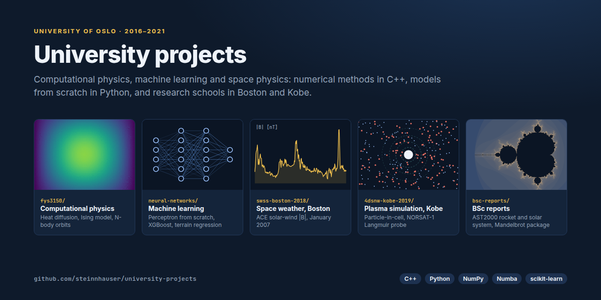
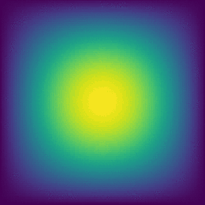
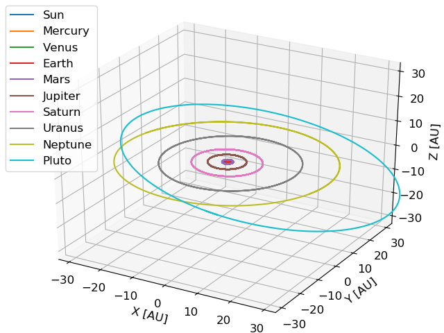
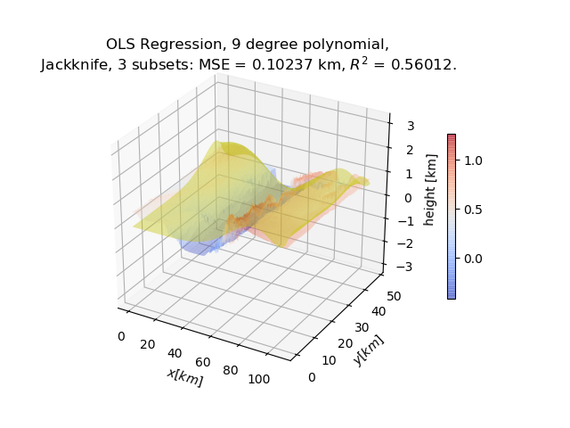
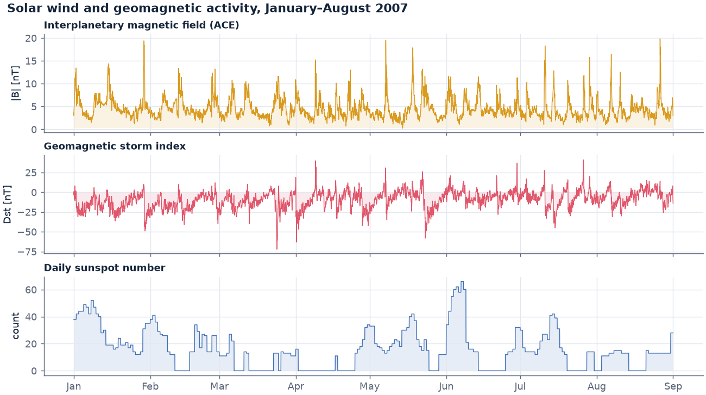
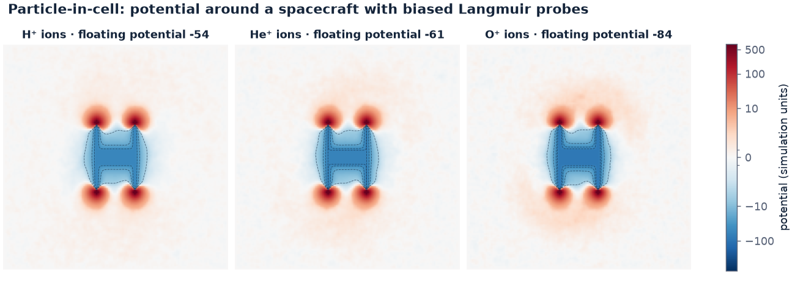
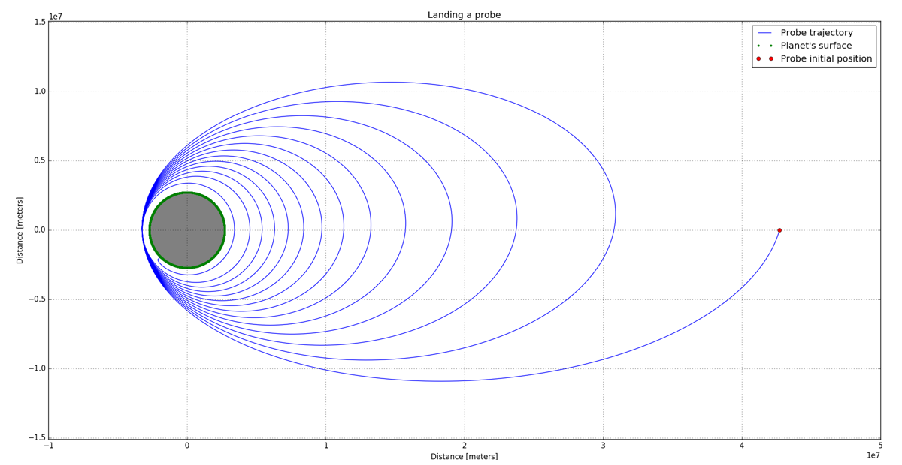
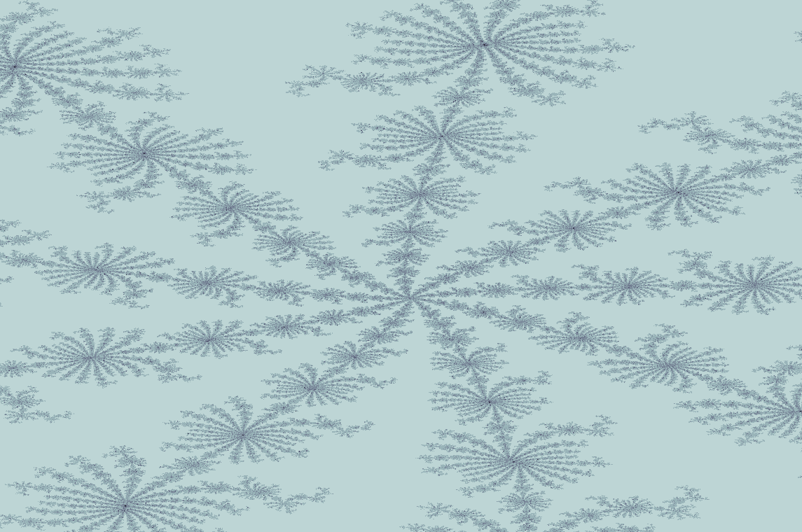

# University Projects



Coursework, research schools and reports from my BSc in Physics and Astronomy (2016–2019) and MSc in Computational Science (2019–2021) at the University of Oslo. Most of it is numerical simulation and data analysis in C++ and Python, written from first principles. My MSc thesis has its own repository: [msc-thesis-lfp](https://github.com/steinnhauser/msc-thesis-lfp).

|     | Project                                                                      | Context                                    | Highlights                                                           |
| --- | ---------------------------------------------------------------------------- | ------------------------------------------ | -------------------------------------------------------------------- |
| 🔥  | [Computational physics](#computational-physics-fys3150)                      | FYS3150, UiO, 2018                         | Heat diffusion, Ising model, solar system, eigenvalue problems (C++) |
| 🧠  | [Machine learning](#machine-learning-fys-stk4155)                            | FYS-STK4155, UiO, 2019                     | Neural network from scratch, XGBoost, terrain regression (Python)    |
| ☀️  | [Space weather](#space-weather-swss-boston-2018)                             | Space Weather Science School, Boston, 2018 | Solar wind and geomagnetic storms from NOAA data                     |
| ⚡  | [Plasma simulation](#plasma-simulation-4dsnw-kobe-2019)                      | 4D Space Numerical Workshop, Kobe, 2019    | Particle-in-cell model of a satellite's Langmuir probes              |
| 🚀  | [Rockets, orbits and fractals](#rockets-orbits-and-fractals-bsc-reports)     | BSc coursework, 2017–2019                  | Rocket engine, probe landing, Mandelbrot package                     |

---

## Computational physics (FYS3150)

<p align="center">
  
  &nbsp;
  
</p>
<p align="center"><sub>Left: 2D heat diffusion (Project 5). Right: the full solar system integrated with velocity Verlet (Project 3).</sub></p>

Five projects on core numerical methods, written in C++ with Armadillo and analysed in Python. Each has a report in [`fys3150/Reports/`](fys3150/Reports/).

| #   | Project                                                  | Method                                                   | Report                                                  |
| --- | -------------------------------------------------------- | -------------------------------------------------------- | ------------------------------------------------------- |
| 1   | Poisson's equation in 1D                                 | Thomas algorithm vs. LU decomposition                    | [PDF](fys3150/Reports/Project1_Poisson-Equation.pdf)    |
| 2   | Buckling beam and two electrons in a harmonic oscillator | Jacobi eigenvalue rotation                               | [PDF](fys3150/Reports/Project2_Buckling-Beam.pdf)       |
| 3   | The solar system in 3D                                   | Object-oriented N-body simulation, velocity Verlet       | [PDF](fys3150/Reports/Project3_Solar-System.pdf)        |
| 4   | 2D Ising model and phase transitions                     | Metropolis Monte Carlo                                   | [PDF](fys3150/Reports/Project4_Ising-Model.pdf)         |
| 5   | Heat diffusion in the lithosphere                        | Explicit, implicit and Crank–Nicolson schemes, 1D and 2D | [PDF](fys3150/Reports/Project5_Heat-Diffusion.pdf)      |

Written together with [Simen Haapnes](https://github.com/simehaa).

## Machine learning (FYS-STK4155)

<p align="center">
  
</p>
<p align="center"><sub>A 9th-degree polynomial fitted to real terrain around the Dead Sea, with jackknife resampling.</sub></p>

- **[Perceptron](neural-networks/Perceptron/)**: a multilayer neural network written from scratch, with backpropagation and configurable learning rates, activation and cost functions, trained to predict credit card defaults.
- **[Terrain regression](neural-networks/TerrainRegression/)**: OLS, Ridge and Lasso on Franke's function and real terrain data, with k-fold and jackknife resampling. See the [report](neural-networks/TerrainRegression/report.pdf).
- **[Extended MNIST](neural-networks/ExtendedMNIST/)**: a study of XGBoost on handwritten characters.
- **[Other](neural-networks/Other/)**: smaller experiments with scikit-learn and TensorFlow, and statistics coursework.

## Space weather (SWSS Boston 2018)

<p align="center">
  
</p>

At the Space Weather Science School in Boston, I analysed how the solar wind drives geomagnetic activity. The project compares the interplanetary magnetic field measured by the ACE and STEREO-B spacecraft with the Dst storm index and sunspot counts. Sharp jumps in |B| line up with dips in Dst, the signature of geomagnetic storms. Code: [`Data_Analysis.py`](swss-boston-2018/Project_ACE-STB/Data_Analysis.py). Slides: [`SWSS_2018.pptx`](swss-boston-2018/SWSS_2018.pptx).

## Plasma simulation (4DSNW Kobe 2019)

<p align="center">
  
</p>

At the 4D Space Numerical Workshop in Kobe, our team used particle-in-cell simulations on the Kobe University supercomputer to model the Langmuir probes on the Norwegian NORSAT-1 satellite. The figure shows a slice of the simulated electric potential for three ionospheric compositions. The spacecraft charges negatively, and more so with heavier ions (floating potential −54, −61, −84), while the biased probes stand out as positive hot spots. Run outputs are in [`4dsnw-kobe-2019/Kobe/`](4dsnw-kobe-2019/Kobe/), with the team's [presentation](4dsnw-kobe-2019/Kobe/Presentation_Friendly-Ions.pptx).

## Rockets, orbits and fractals (BSc reports)

<p align="center">
  
  &nbsp;
  
</p>
<p align="center"><sub>Left: landing a probe on a planet in a simulated solar system (AST2000). Right: a deep zoom computed with the Mandelbrot package.</sub></p>

- **AST2000, astrophysics** (2017):
  - [Simulation of a rocket engine](bsc-reports/BSc-Reports/Year-2/AST2000_RocketEngine.pdf): hot hydrogen gas in many small boxes provides the thrust to reach escape velocity within 20 minutes.
  - [Simulation of a solar system](bsc-reports/BSc-Reports/Year-2/AST2000_SolarSystem.pdf): planetary orbits and the landing of a probe.
  - [Analyses of a solar system](bsc-reports/BSc-Reports/Year-2/AST2000_DataAnalyses.pdf): finding planets in stellar data.
- **[Mandelbrot package](bsc-reports/BSc-Reports/Year-3/Mandelbrot-Package/)** (2018): a tested Python package with pure-Python, NumPy and Numba implementations, and a command-line interface for exploring any region of the set.
- **FYS2130 and FYS2140** (2018): projects in [oscillations and waves](bsc-reports/BSc-Reports/Year-2/Project-2130_SteinnHauser.pdf) and [quantum physics](bsc-reports/BSc-Reports/Year-2/Project-2140_SteinnHauser.pdf).

---

## Figures

The heat-diffusion animation, the space-weather plot and the plasma plot are generated from data in this repository by [`docs/make_figures.py`](docs/make_figures.py):

```sh
uv run --no-project --with matplotlib --with numpy --with h5py --with pillow python docs/make_figures.py
```

The solar-system and probe-landing figures are taken from the project reports.

## History

This repository started as `FYS3150` and was later renamed. The other folders were merged in from their own repositories
(`Neural-Networks`, `Project-Reports`, `SWSS-Boston-2018`, `4DSNW-2019`) with all their commits kept.
`git log --follow <file>` shows a file's history from before the move.

## Credits

- FYS3150 was written together with [Simen Haapnes](https://github.com/simehaa), who also contributed to `neural-networks/`.
- The 4DSNW "Friendly Ions" team: Jessie Warraich, Azumi Nawata, Miho Okamura and Shuji Doi. The floating potential lecture in that folder is by one of the workshop lecturers.
- Space weather data in `swss-boston-2018/` is from [NOAA SWPC](https://www.swpc.noaa.gov/).
